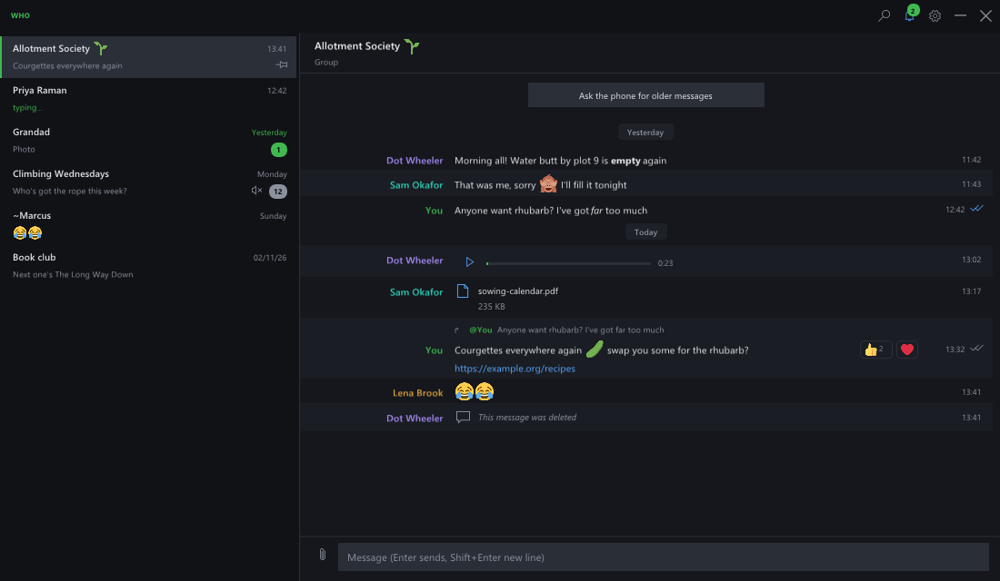

# Who

A small WhatsApp client for Windows, in place of WhatsApp's own app. Chats
down the left, the conversation beside them in rows (names in a column,
like a chat client rather than bubbles), a bell in the title bar for new
messages, and closing to the tray.



It signs in as a linked device, like WhatsApp Web: scan the QR code from
the phone's Settings > Linked devices. The phone stays the main device.

**Unofficial.** Who uses [whatsmeow](https://github.com/tulir/whatsmeow), a
reimplementation of WhatsApp Web's protocol. Using unofficial clients is
against WhatsApp's terms and could get an account suspended.

## What it does

- Chats: pinned first, unread counts, muted and archived (archived behind
  a row at the top), search by name, typing shown.
- Messages: WhatsApp's formatting (`*bold*`, `_italic_`, `~strike~`,
  `` `code` ``, ```` ``` ````), links, colour emoji (Twemoji), replies,
  reactions, edits and deletions, read ticks, history sent by the phone
  (and more on request).
- Media: pictures and stickers shown (click for a viewer), voice messages
  played in place (Ogg Opus via libopus), videos, music and documents
  opened in their own apps, anything saved with right-click.
- Sending: text, replies (right-click a message), reactions, files by the
  paperclip, paste or drag and drop (the typed text becomes the caption).
- Marked online only while its window is in front, like WhatsApp Web, so
  the phone still gets notifications otherwise.
- Not: calls, Status, Channels, Communities, polls (shown, not votable),
  recording voice messages.

## How it's built

- `engine/`: **who-engine**, Go. whatsmeow plus an SQLite message store
  (`modernc.org/sqlite`, no cgo), run hidden by the window and spoken to
  with JSON lines on stdin and stdout (commands and events are listed at
  the top of `engine/protocol.go`). Its data, session and downloaded media
  live in `%LOCALAPPDATA%\who`, its log in `engine.log` there.
- `src/`: the window, C++ (Win32, Direct3D 11, Dear ImGui 1.92). Rich text,
  emoji and image loading come from disky.

## Building

1. The engine: `cd engine && GOOS=windows GOARCH=amd64 CGO_ENABLED=0 go build
   -ldflags "-s -w -H=windowsgui" -o ../build/who-engine.exe .`
2. The window: `build.bat` (Visual Studio 2022 C++ tools), with Opus in
   `deps\include\opus` and `deps\lib\opus.lib` (vcpkg's
   `opus:x64-windows-static`). It builds `build\who.exe` and runs
   `build\tests.exe`.

Put `who-engine.exe` beside `who.exe`. `who.exe -tray` starts in the tray.

Testing: `WHO_DATA=<folder>` uses its own data and runs beside a real Who
without taking focus; `WHO_DEMO=1` shows made-up chats and starts no engine;
`-place x,y,w,h` puts the window; with `WHO_DEMO`, `WHO_INPUT` plays a mouse script
(`wait 30;move 965 18;down;wait 1;up`), logged to `input.log`. `tools/icon.py` draws the icon.
